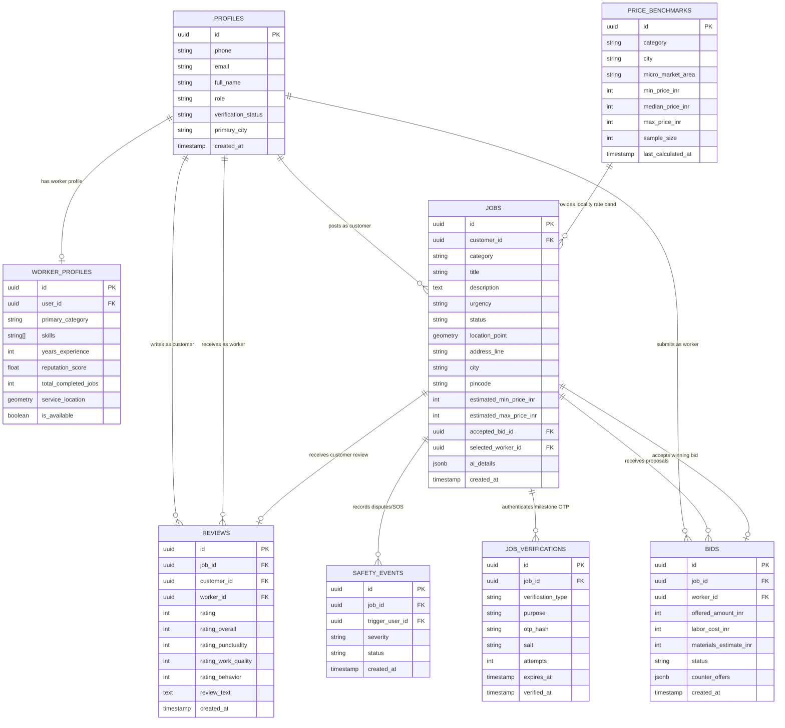

# Sahayak — Complete Project Master Documentation

> **Document Type:** Master Technical Documentation & Single Source of Truth  
> **Repository:** Sahayak Hyperlocal Household Services Marketplace  
> **Repository Remote:** `https://github.com/Radhikakalbhor/Hacksmiths_Radhikakalbhor.git`  
> **Current Version:** `0.1.0` (Next.js 16.4.3 App Router, React 19.3.0, TypeScript 5, Supabase PostgreSQL with PostGIS)  
> **Documentation Date:** October 25, 2026  
> **Author:** Antigravity Engineering Assistant (Google DeepMind Advanced Agentic Coding)

---

## Table of Contents

- [1. Project Overview](#1-project-overview)
- [2. Problem Statement and Motivation](#2-problem-statement-and-motivation)
- [3. Target Users and Roles](#3-target-users-and-roles)
- [4. Complete Technology Stack](#4-complete-technology-stack)
- [5. System Architecture](#5-system-architecture)
- [6. Complete Project Directory Structure](#6-complete-project-directory-structure)
- [7. Frontend Architecture and Pages](#7-frontend-architecture-and-pages)
- [8. Backend and API Reference](#8-backend-and-api-reference)
- [9. Database Architecture and Data Model](#9-database-architecture-and-data-model)
- [10. Authentication and Authorization](#10-authentication-and-authorization)
- [11. Complete Feature Catalogue](#11-complete-feature-catalogue)
- [12. Detailed Job and Booking Lifecycle](#12-detailed-job-and-booking-lifecycle)
- [13. Pricing and Recommendation Algorithms](#13-pricing-and-recommendation-algorithms)
- [14. Location, Geospatial Search, and Tracking](#14-location-geospatial-search-and-tracking)
- [15. AI and External Integrations](#15-ai-and-external-integrations)
- [16. Environment Variables and API Keys](#16-environment-variables-and-api-keys)
- [17. Data Sources, Datasets, Seed Data, and Demo Data](#17-data-sources-datasets-seed-data-and-demo-data)
- [18. Reviews, Ratings, and Trust Mechanisms](#18-reviews-ratings-and-trust-mechanisms)
- [19. Security and Privacy](#19-security-and-privacy)
- [20. Error Handling and Edge Cases](#20-error-handling-and-edge-cases)
- [21. Testing and Quality Assurance](#21-testing-and-quality-assurance)
- [22. Local Setup and Developer Guide](#22-local-setup-and-developer-guide)
- [23. Deployment and Hosting](#23-deployment-and-hosting)
- [24. Dependencies and Package Inventory](#24-dependencies-and-package-inventory)
- [25. Limitations, Technical Debt, and Unverified Areas](#25-limitations-technical-debt-and-unverified-areas)
- [26. Complete End-to-End User Journeys](#26-complete-end-to-end-user-journeys)
- [27. Feature-to-Code Traceability Matrix](#27-feature-to-code-traceability-matrix)
- [28. Glossary](#28-glossary)
- [29. Final Project Status Summary](#29-final-project-status-summary)
- [30. Documentation Evidence and Inspection Notes](#30-documentation-evidence-and-inspection-notes)

---

## 1. Project Overview

### 1.1 Project Name and Purpose
**Sahayak** (Hindi: **सहायक** — *"Helper"* / *"Assistant"*) is an open, transparent, hyperlocal household services marketplace built for Indian urban ecosystems (primarily Delhi NCR and Mumbai). The platform connects residential and commercial customers directly with verified, skilled local gig workers across essential daily trades including plumbing, electrical repair, home cleaning, carpentry, painting, appliance diagnostics, and cooking.

### 1.2 Short Description of the Application
Sahayak eliminates exploitative aggregator intermediary commissions (typically 25% to 35% on platforms like Urban Company) and unorganized contractor uncertainty. It enables customers to either:
1. **Broadcast open service requests** with customizable categories, budgets, and GPS locations to receive competitive bids from neighborhood professionals.
2. **Book on-demand directly (Uber/Rapido style)** by selecting available nearby workers with real-time distance calculations, agreed price confirmation, cryptographically salted 4-digit arrival OTP validation, countdown tracking, and two-way in-app communication.

### 1.3 Real-World Problem Addressed
In Indian metropolitan areas, finding trustworthy, fairly priced home service help is fraught with three structural failures:
* **Aggregator Monopolies & Hidden Markups:** Aggregators impose hefty markups on customers while taking 20–35% cuts from unorganized blue-collar technicians.
* **Information Asymmetry & Price Gouging:** Customers lack locality-specific price transparency, causing wide quote discrepancies for identical jobs.
* **Safety & Identity Vulnerabilities:** Traditional unorganized workers lack background verifications or start/completion authentication handoffs, creating mutual trust deficits.

### 1.4 Target Users and Stakeholders
* **Urban Indian Customers:** Homeowners and tenants seeking immediate, safe, and transparently priced skilled labor without carrier call delays.
* **Blue-Collar Independent Workers:** Technicians, tradespeople, and domestic workers who retain 100% of their earned service fares, build portable reputation passports, and control their own quotes.
* **Neighborhood Communities:** Resident Welfare Associations (RWAs) and apartment societies requiring verified service history and authenticated physical arrivals.

### 1.5 Proposed Solution
Sahayak implements a zero-commission, direct-to-worker architecture powered by Supabase PostgreSQL, PostGIS spatial indexing, and Next.js 16 App Router:
* **Fair Price Benchmark Matrix:** Transparent micro-market benchmark comparisons (`Below Range`, `Fair Price`, `Above Range`, `Benchmark unavailable`).
* **Best Match Engine:** Multi-factor recommendation algorithm balancing worker proximity (distance in km), price fairness, and verified reputation score.
* **Two-Stage Cryptographic OTP Authentication:** Offline-verifiable, salted SHA-256 arrival OTP handoffs to ensure work starts only when the authorized technician physically arrives at the door.
* **Live Job Tracking & 2-Way Messaging:** Real-time milestone stepper (`Posted → Bids Received → Accepted → Arrived → Completed`), travel countdown, and in-app chat with contextual simulation for demo accounts.
* **Customer Savings Audit:** Transparent calculation of `local median benchmark − accepted bid amount` displayed without misleading guarantees.
* **Single-Review Verification:** Strictly enforced 1-review-per-completed-job constraint ensuring worker ratings reflect only genuine fulfilled work, displaying `Not rated yet` for unrated professionals.

### 1.6 Current Scope: Implemented vs Incomplete Functionality
* **Fully Implemented & Verified:**
  * PostGIS spatial worker discovery within adjustable radial distances (5 km to 50 km).
  * Flexible service request creation with custom service categories, auto-generated titles, GPS coordinates, and duration guidance.
  * Competitive bidding, counter-offering, and atomic bid acceptance via PostgreSQL RPC.
  * Instant "Book Now" direct worker booking with agreed price and customer OTP issuance.
  * Job Status Timeline with 5 distinct milestones and cancellation reason tracking.
  * Fair Price Badge and Best Match multi-factor ranking with natural-language justification.
  * "You Saved ₹X" benchmark comparison against local median values.
  * Verified review submission (1–5 stars with text) restricted to authenticated job owners.
  * Booking History dashboard with status filters (All, Active, Completed, Cancelled).
  * In-app two-way messaging with automatic contextual demo replies for demo workers.
  * Full unit test suite (115 tests passing across 27 suites).
* **Partially Implemented / Simulated:**
  * Real-time GPS movement: Simulated via client countdown and fixed PostGIS distance calculation rather than live continuous background GPS pings.
  * Phone Calling: Opens `tel:` URI for real numbers; opens simulated in-app modal for demo worker numbers (`+9199990000XX`).
  * AI Gemini Parsing: Environment variable `GEMINI_API_KEY` and configuration exist in `src/lib/config/env.ts`, but active job creation utilizes deterministic heuristic normalization and rule-based processing.
* **Unimplemented / Future Roadmap:**
  * Integrated payment gateway (Razorpay/UPI escrow) — all current bookings assume direct cash/UPI settlement between customer and worker.
  * Native mobile iOS/Android apps (currently responsive Web App).

---

## 2. Problem Statement and Motivation

### 2.1 The Friction in Urban Household Labor
Home service procurement in India has historically oscillated between two broken extremes:
1. **The Informal Sector (Nukkad / Local Hardware Referrals):**
   * Unpredictable availability and long wait times.
   * Arbitrary pricing with zero written estimates.
   * Zero background checks, safety checks, or formal dispute resolution.
   * Cash transactions with no warranty or recourse.
2. **Aggregator Oligopolies (Urban Company, Housejoy, etc.):**
   * High service prices with 25%–35% platform commission overheads.
   * Rigid, standardized service packages that fail to accommodate small, ad-hoc, or custom repairs.
   * Worker disempowerment: Workers operate as pseudo-employees without quote autonomy, bearing transport risks and algorithmic penalties.

### 2.2 How Sahayak Solves Each Component

| Problem Dimension | Industry Reality | Sahayak Implementation | Evidence in Codebase |
| :--- | :--- | :--- | :--- |
| **Pricing Transparency** | Secret algorithms and arbitrary dynamic surges. | Public micro-market benchmark bands (`min`, `median`, `max`) per category and city. | `src/lib/services/pricing.service.ts`, table `price_benchmarks` |
| **Worker Discovery** | Opaque automated matching without worker choice. | Spatial PostGIS radius queries returning name, distance, rating, trade skills, and experience. | `src/app/api/workers/nearby/route.ts`, RPC `find_nearby_workers` |
| **Bid Comparison** | Customers must accept whatever price an aggregator dictates. | Open bidding with counter-offers, Fair Price badges, and multi-factor Best Match ranking. | `src/app/api/jobs/[id]/bids/route.ts`, `src/app/dashboard/page.tsx` |
| **Arrival Security** | Unverified arrival claims; workers calling repeatedly for directions. | 4-digit salted cryptographic OTP generated on customer screen, verified before job status turns `in_progress`. | `src/lib/services/booking.service.ts`, table `job_verifications` |
| **Cancellation Protection** | Opaque penalty fees and confusing cancellation flows. | Structured cancellation modal with 6 mandatory reasons, stopping tracking and restoring job status. | `src/app/jobs/[id]/page.tsx`, `src/app/api/jobs/[id]/booking-status/route.ts` |
| **Reputation Reliability** | Fabricated 5-star ratings or unverified reviews. | Reviews allowed strictly after verified completion, enforced at database and API levels; unrated workers show "Not rated yet". | `src/app/api/jobs/[id]/review/route.ts`, table `reviews` |

---

## 3. Target Users and Roles

The application strictly defines and enforces roles across authentication helpers (`src/lib/auth/server.ts`), database types (`src/types/database.types.ts`), and Supabase RLS policies (`20261024000002_row_level_security.sql`).

```
                    ┌─────────────────────────────────┐
                    │      Supabase Auth Session      │
                    └────────────────┬────────────────┘
                                     │
                 ┌───────────────────┴───────────────────┐
                 ▼                                       ▼
        ┌────────────────┐                      ┌────────────────┐
        │    Customer    │                      │     Worker     │
        │ (Default Role) │                      │ (Service Pro)  │
        └────────┬───────┘                      └────────┬───────┘
                 │                                       │
                 ├─ Post Jobs                            ├─ Discover Open Jobs
                 ├─ Receive & Compare Bids               ├─ Submit & Counter Bids
                 ├─ Direct "Book Now"                    ├─ Update Transit Status
                 ├─ View 4-Digit Arrival OTP             ├─ Verify Customer OTP
                 ├─ Cancel Bookings                      ├─ Complete Service
                 └─ Submit Verified Reviews              └─ Build Reputation Passport
```

### 3.1 Customer Role (`role = 'customer'`)
* **Identity:** Standard residential or commercial client posting service requests.
* **Accessible Routes:** `/post-job`, `/dashboard`, `/bookings`, `/jobs/[id]`, `/api/jobs` (POST/GET), `/api/jobs/[id]/book-now`, `/api/jobs/[id]/accept-bid`, `/api/jobs/[id]/review`.
* **Data Access Permissions:**
  * Can read and write only their own jobs (`customer_id = auth.uid()`).
  * Can read bids submitted for their jobs.
  * Can view secret 4-digit arrival OTPs for their bookings.
  * Can submit exactly one review per completed job.
  * Cannot view customer OTPs of other users.

### 3.2 Worker Role (`role = 'worker'`)
* **Identity:** Independent skilled service professional (plumber, electrician, cleaner, etc.).
* **Linked Data:** Must have an entry in `public.profiles` (`role = 'worker'`) and an associated row in `public.worker_profiles`.
* **Accessible Routes:** Discovery of open jobs on `/dashboard`, `/api/jobs/[id]/bids` (POST), transit milestones on `/api/jobs/[id]/booking-status` (PATCH).
* **Data Access Permissions:**
  * Can view open jobs within their geographic service radius.
  * Can view and submit bids on open jobs.
  * Can view sanitized customer addresses and directions once their bid is accepted.
  * Can input customer arrival OTPs to start work.
  * Cannot view the plain-text customer OTP in API payloads (`src/app/api/jobs/[id]/route.ts` strips `customerOtp` for non-customers).

### 3.3 Administrator Role (`role = 'admin'`)
* **Status in Codebase:** The type `UserRole` in `src/types/database.types.ts` defines `'customer' | 'worker' | 'admin'`. RLS policies in `20261024000002_row_level_security.sql` grant bypass privileges to users whose profile role is `'admin'`.
* **Current UI Implementation:** No dedicated `/admin` frontend dashboard exists in the repository. Administrative actions are executed directly via Supabase Studio or the server-side service role client (`getSupabaseAdminClient()`).

### 3.4 Demo / Simulated Users
* **Status:** 13 verified fictional accounts seeded via `scripts/seed-demo.mjs` with email domain `@sahayak.demo.internal` and phone prefix `+9199990000XX`.
* **Behavior:** When booked, demo workers trigger client-side countdown tracking and generate contextual simulated chat responses prefixed with `[Demo Simulation]` (`src/app/api/jobs/[id]/messages/route.ts`).

---

## 4. Complete Technology Stack

| Layer | Technology | Version | Purpose | Where It Is Used | Evidence / File Path |
| :--- | :--- | :--- | :--- | :--- | :--- |
| **Framework** | Next.js | `16.4.3` | Fullstack App Router, Turbopack, Partial Prerendering (PPR), Server Components & Route Handlers | Entire Web App & REST APIs | `package.json`, `next.config.ts` |
| **UI Runtime** | React | `19.3.0` | Declarative UI rendering, hooks, transitions | All frontend components | `package.json` |
| **Language** | TypeScript | `^5` | Strict static typing across schema, APIs, services, and UI | Codebase-wide (`tsconfig.json`) | `tsconfig.json`, `src/types/*` |
| **Styling** | Tailwind CSS | `^4.0` | Modern CSS-in-JS utility tokens, responsive layouts, glassmorphism | Application styling | `package.json`, `src/app/globals.css` |
| **Icons** | Lucide React | `^1.61.0` | Comprehensive icon library | Navigation, badges, status indicators | `src/components/*`, `src/app/*` |
| **Database** | PostgreSQL | `15+` (Supabase) | Relational storage, ACID transactions, check constraints, foreign keys | Core database | `supabase/migrations/*` |
| **Spatial Engine** | PostGIS | `3.3+` | Geospatial indexing (`GIST`), coordinate points (`GEOMETRY(Point, 4326)`), distance queries | Nearby worker search, radius filtering | `supabase/migrations/20261024000003_postgis_nearby_workers.sql` |
| **Database Client** | Supabase JS | `^2.118.0` | Server and client-side database interaction, typed RPC execution, auth sessions | Data fetching & mutation | `src/lib/supabase/*`, `package.json` |
| **Auth Adapter** | Supabase SSR | `^0.12.7` | Cookie-based session storage across Next.js Server Components and Route Handlers | Authentication flow | `src/lib/supabase/server.ts`, `package.json` |
| **Crypto** | Node.js `crypto` | Built-in | Cryptographic pseudo-random OTP generation, SHA-256 salted hashing | Verification & security services | `src/lib/services/safety.service.ts`, `src/lib/services/booking.service.ts` |
| **Test Runner** | Node.js Test Runner | Built-in (`node:test`) | Native test framework running TypeScript unit tests via TSX | Unit & regression testing | `package.json`, `src/tests/unit/*` |
| **TS Execution** | TSX | `^4.23.15` | Fast TypeScript execution for tests and seeding scripts | `npm test`, `scripts/seed-demo.mjs` | `package.json` |
| **Linting** | ESLint | `^9` | Static code analysis and Next.js rule verification | Quality assurance | `eslint.config.mjs`, `package.json` |
| **Version Control**| Git / GitHub | Remote: `main` | Source code management | GitHub repository | `.git/config` |

---

## 5. System Architecture

### 5.1 High-Level Architecture Diagram

```mermaid
flowchart TD
    subgraph ClientLayer["Frontend Client (Browser)"]
        Landing["Landing Page (/)"]
        Dashboard["Dashboard & Bids (/dashboard)"]
        PostJob["Post Job (/post-job)"]
        JobDetails["Tracking & Chat (/jobs/[id])"]
        Bookings["Booking History (/bookings)"]
        AuthModal["Login (/login)"]
    end

    subgraph ServerLayer["Next.js 16 App Router (Server-Side)"]
        AuthMiddleware["Server Auth & Role Guard (src/lib/auth/server.ts)"]
        JobsAPI["/api/jobs & /api/jobs/[id]"]
        BidsAPI["/api/jobs/[id]/bids & counter"]
        BookingAPI["/api/jobs/[id]/book-now & status"]
        MessagesAPI["/api/jobs/[id]/messages"]
        ReviewsAPI["/api/jobs/[id]/review"]
        NearbyAPI["/api/workers/nearby"]
        BookingsAPI["/api/bookings"]
    end

    subgraph ServiceLayer["Domain Services (src/lib/services/)"]
        PricingSvc["PricingService (Benchmarks & Scoring)"]
        BookingSvc["BookingService (Lifecycle & OTP)"]
        JobsSvc["JobsService (Preparation & State Machine)"]
        WorkersSvc["WorkersService (PostGIS Queries)"]
        SafetySvc["SafetyService (SHA-256 Salted Hashing)"]
    end

    subgraph DatabaseLayer["Supabase PostgreSQL (Database)"]
        ProfilesTbl[("public.profiles")]
        WorkerProfilesTbl[("public.worker_profiles")]
        JobsTbl[("public.jobs")]
        BidsTbl[("public.bids")]
        BenchmarksTbl[("public.price_benchmarks")]
        VerificationsTbl[("public.job_verifications")]
        ReviewsTbl[("public.reviews")]
        SpatialRPC[("RPC: find_nearby_workers (PostGIS)")]
        AtomicAcceptRPC[("RPC: accept_job_bid (Atomic Lock)")]
    end

    %% Client to Server Routes
    Landing --> AuthModal
    PostJob -->|POST /api/jobs| JobsAPI
    Dashboard -->|GET /api/jobs, /api/jobs/[id]/bids| BidsAPI
    JobDetails -->|POST book-now, PATCH booking-status| BookingAPI
    JobDetails -->|GET, POST /messages| MessagesAPI
    JobDetails -->|POST /review| ReviewsAPI
    Bookings -->|GET /api/bookings| BookingsAPI

    %% Server to Middleware & Services
    JobsAPI --> AuthMiddleware
    BidsAPI --> AuthMiddleware
    BookingAPI --> AuthMiddleware
    MessagesAPI --> AuthMiddleware
    ReviewsAPI --> AuthMiddleware

    JobsAPI --> JobsSvc
    BidsAPI --> PricingSvc
    BookingAPI --> BookingSvc
    BookingAPI --> SafetySvc
    NearbyAPI --> WorkersSvc

    %% Services to Database
    JobsSvc --> JobsTbl
    PricingSvc --> BenchmarksTbl
    BookingSvc --> VerificationsTbl
    BookingSvc --> JobsTbl
    SafetySvc --> VerificationsTbl
    WorkersSvc --> SpatialRPC
    BidsAPI --> AtomicAcceptRPC
    ReviewsAPI --> ReviewsTbl
    ReviewsAPI --> WorkerProfilesTbl
```

### 5.2 Communication Flows and Session Management
1. **Client $\leftrightarrow$ Server:** All client communication with the backend happens via standard browser `fetch` calls to Next.js REST API route handlers (`/api/*`). Authentication tokens are transported via HTTP-only secure cookie sessions managed by `@supabase/ssr`.
2. **Server $\leftrightarrow$ Database:** Route handlers use typed Supabase clients (`src/lib/supabase/server.ts` or privileged `src/lib/supabase/admin.ts`). Queries enforce PostgreSQL Row-Level Security (RLS) policies matching the authenticated caller's Supabase User ID (`auth.uid()`).
3. **State Management:** Frontend pages utilize React 19 component state (`useState`, `useCallback`, `useRef`, `useEffect`) and URL parameters (`useParams`). No global Redux or Zustand store is used, keeping bundle size minimal and dependencies lean.
4. **Error Handling Strategy:** All API routes wrap execution in `try...catch` blocks and return standardized JSON responses via `apiSuccess()` or `apiError()` (`src/lib/api/response.ts`), ensuring client applications receive structured `{ success: false, error: string, code: string }` error schemas.

---

## 6. Complete Project Directory Structure

```text
c:\Users\radhi\OneDrive\Desktop\Sahayak
├── .env.example                                # Public template for environment variables
├── .env.local                                  # Local environment configuration (IGNORED BY GIT)
├── .gitignore                                  # Git exclusion rules
├── AGENTS.md                                   # Workspace-specific Next.js rules
├── eslint.config.mjs                           # ESLint configuration
├── next.config.ts                              # Next.js 16 compiler & caching settings
├── package.json                                # Dependencies, scripts, and package metadata
├── package-lock.json                           # Deterministic dependency lockfile
├── README.md                                   # Introductory repository overview
├── tsconfig.json                               # TypeScript configuration
├── public/                                     # Static public assets (icons, SVGs, favicon)
├── scripts/                                    # Automation and seeding utilities
│   ├── seed-demo.mjs                           # Official Supabase Auth Admin seeding script (13 demo users)
│   └── seed-validation.mjs                     # Structural verification for seed payloads
├── supabase/                                   # Database migrations, seeds, and SQL scripts
│   ├── migrations/                             # 10 ordered SQL migrations
│   │   ├── 20261024000001_initial_schema.sql
│   │   ├── 20261024000002_row_level_security.sql
│   │   ├── 20261024000003_postgis_nearby_workers.sql
│   │   ├── 20261024000004_atomic_marketplace_operations.sql
│   │   ├── 20261024000005_grant_public_table_privileges.sql
│   │   ├── 20261024000006_fix_profiles_policy_recursion.sql
│   │   ├── 20261024000007_expand_jobs_and_worker_categories.sql
│   │   ├── 20261025000008_booking_lifecycle_and_messages.sql
│   │   ├── 20261025000009_allow_flexible_job_description.sql
│   │   └── 20261025000010_expand_jobs_urgency_check.sql
│   ├── seed.sql                                # Minimal database seed
│   ├── seed_demo_data.sql                      # Comprehensive SQL seed data (jobs, bids, benchmarks)
│   └── seed_demo_workers.sql                   # Standalone worker seed data
└── src/                                        # Application source code
    ├── app/                                    # Next.js 16 App Router
    │   ├── api/                                # REST Route Handlers
    │   │   ├── bookings/route.ts               # Customer booking history API
    │   │   ├── health/route.ts                 # Healthcheck, database status & latency
    │   │   ├── jobs/
    │   │   │   ├── route.ts                    # Job creation and discovery
    │   │   │   └── [id]/
    │   │   │       ├── route.ts                # Single job details & customer benchmark
    │   │   │       ├── accept-bid/route.ts     # Atomic winning bid acceptance
    │   │   │       ├── bids/
    │   │   │       │   ├── route.ts            # Enriched bids with Fair Price & Best Match
    │   │   │       │   └── [bidId]/counter/route.ts # Bid counter-offers
    │   │   │       ├── book-now/route.ts       # Direct worker booking initiation
    │   │   │       ├── booking-status/route.ts # Stage transitions, OTP & cancellation
    │   │   │       ├── messages/route.ts       # 2-way chat with demo simulation
    │   │   │       └── review/route.ts         # Verified customer review submission
    │   │   └── workers/
    │   │       └── nearby/route.ts             # PostGIS radial worker discovery
    │   ├── auth/callback/route.ts              # Supabase OAuth/Magic Link exchange
    │   ├── bookings/page.tsx                   # Dedicated Booking History UI
    │   ├── dashboard/page.tsx                  # Marketplace & Customer Jobs Dashboard
    │   ├── jobs/[id]/page.tsx                  # Live Job Discovery, Tracking, Stepper & Review
    │   ├── login/page.tsx                      # Magic link and OTP login screen
    │   ├── post-job/page.tsx                   # Create Service Request posting form
    │   ├── globals.css                         # Global CSS & Tailwind imports
    │   ├── layout.tsx                          # Root layout with Header & Footer
    │   └── page.tsx                            # Landing & marketing homepage
    ├── components/                             # Reusable React components
    │   ├── landing/                            # Landing page sections (Hero, Grid, Safety)
    │   ├── layout/                             # Global Navbar and Footer
    │   └── ui/                                 # Base UI primitives (Button, Card, Badge)
    ├── lib/                                    # Core libraries and domain logic
    │   ├── api/response.ts                     # Uniform API JSON response helpers
    │   ├── auth/server.ts                      # Server-side auth verification & role guards
    │   ├── config/                             # Constants and runtime environment validation
    │   │   ├── constants.ts                    # Trades, categories, city bounds
    │   │   └── env.ts                          # Safe server/client environment wrapper
    │   ├── services/                           # Pure business logic services
    │   │   ├── booking.service.ts              # OTP, travel estimation & transitions
    │   │   ├── jobs.service.ts                 # PostGIS formatting & constraint reconciliation
    │   │   ├── pricing.service.ts              # Benchmark evaluation, savings & scoring
    │   │   ├── safety.service.ts               # Cryptographic SHA-256 OTP hashing
    │   │   └── workers.service.ts              # PostGIS radial search & reputation tiers
    │   ├── supabase/                           # Supabase client instantiation
    │   │   ├── admin.ts                        # Privileged Service Role client
    │   │   ├── client.ts                       # Browser singleton client
    │   │   └── server.ts                       # Server Cookie-based client
    │   ├── utils/cn.ts                         # Tailwind class merge utility
    │   └── validations/                        # Input validation schemas & functions
    │       ├── auth.ts                         # Login & phone number validation
    │       ├── jobs.ts                         # Job creation & bid input validation
    │       └── workers.ts                      # Worker profile update validation
    ├── tests/                                  # Automated test suites
    │   └── unit/                               # 11 Unit test files (115 tests)
    │       ├── auth-authorization.test.ts
    │       ├── bidding-and-atomic-acceptance.test.ts
    │       ├── booking-and-tracking.test.ts
    │       ├── booking-history.test.ts
    │       ├── demo-seed-validation.test.ts
    │       ├── five-features.test.ts           # Focused tests for the 5 key features
    │       ├── job-lifecycle.test.ts
    │       ├── oauth-callback.test.ts
    │       ├── post-job-form-improvements.test.ts
    │       ├── pricing.test.ts
    │       └── validation.test.ts
    └── types/                                  # TypeScript interface declarations
        ├── bids.ts                             # Bids & PriceBenchmark types
        ├── booking.ts                          # BookingStage, BookingState, ChatMessage
        ├── database.types.ts                   # Supabase PostgreSQL schema types
        ├── jobs.ts                             # Job details & status state machines
        ├── reputation.ts                       # Worker reputation passport types
        ├── roles.ts                            # UserRole, VerificationStatus
        └── safety.ts                           # OTP & Safety event types
```

---

## 7. Frontend Architecture and Pages

### 7.1 Page Catalog

#### 1. Home / Landing Page (`/`)
* **Source:** `src/app/page.tsx`
* **Access:** Public (all users).
* **Components:** `HeroSection`, `ServicesGrid`, `BenchmarkPreview`, `SafetyFlow`, `WorkerReputationPreview`, `CallToActionBanner`.
* **Purpose:** Educates visitors on the zero-commission marketplace, showcases the 7 core trade categories, explains the two-stage OTP trust mechanism, and provides one-click entry to post a job or browse workers.

#### 2. Service Request Form (`/post-job`)
* **Source:** `src/app/post-job/page.tsx`
* **Access:** Authenticated customers (redirects unauthenticated users to `/login?redirect=/post-job`).
* **Key Features:**
  * Hyperlocal category selector (`cleaning`, `plumbing`, `electrical`, `carpentry`, `appliance_repair`, `painting`, `cooking`, `maid`, `other`).
  * Custom category name input when `other` is selected.
  * Auto-generated, editable titles based on selected service and locality.
  * Optional detailed description with safe server-side normalization.
  * Browser Geolocation capture (`navigator.geolocation.getCurrentPosition`) filling latitude, longitude, and address estimates.
  * Urgency selector: Standard, Same Day (`urgent`), and Emergency (`emergency`).
  * Indicative duration guidance badge (e.g. `~1.5 - 2.5 hours`).
  * Budget guidance preview comparing input against local benchmark bands.
* **API Called:** `POST /api/jobs`

#### 3. Marketplace & Customer Jobs Dashboard (`/dashboard`)
* **Source:** `src/app/dashboard/page.tsx`
* **Access:** Authenticated users.
* **Key Features:**
  * Tabbed view toggling between **"My Posted Requests"** (customer jobs) and **"Marketplace Feed"** (open local jobs).
  * Collapsible **Job Bids Drawer**: Lists all worker bids submitted for a specific job.
  * **Fair Price Badge:** Renders `Below Range`, `Fair Price`, `Above Range`, or `Benchmark unavailable` on each bid.
  * **Best Match Pill:** Displays `Recommended` / `Best Match` on the highest-scoring candidate with a natural-language reason note.
  * Worker Distance: Shows distance in kilometers (e.g. `1.5 km away`).
  * Real Worker Rating: Displays `★ 4.8 (12 reviews)` or `Not rated yet` (no fake 5.0).
  * **"You Saved ₹X" Banner:** Displays positive savings compared to local median benchmark when a bid is accepted.
  * Actions: "Accept Bid" (invokes atomic RPC), "Counter Offer", and "Book Worker".
* **APIs Called:** `GET /api/jobs`, `GET /api/jobs/[id]/bids`, `POST /api/jobs/[id]/accept-bid`.

#### 4. Job Details, Live Discovery & Tracking (`/jobs/[id]`)
* **Source:** `src/app/jobs/[id]/page.tsx`
* **Access:** Authenticated customer who owns the job, or assigned worker.
* **Key Features:**
  * **Job Status Timeline (Feature 3):** 5-milestone progress stepper (`Posted → Bids Received → Accepted → Arrived → Completed`) with timestamp audits and cancellation notices.
  * **"You Saved ₹X" Card (Feature 4):** Prominent savings banner when `acceptedPrice < benchmarkMedian`.
  * **Nearby Worker Discovery Grid:** Scans PostGIS radius (5 km to 50 km) for verified local workers with distance and travel time estimates.
  * **"Book Now" Confirmation Modal:** Customer enters agreed fare, reviews worker stats, and confirms dispatch.
  * **Secret Customer Arrival OTP:** 4-digit code displayed in bold monospace boxes, strictly hidden from worker API responses.
  * **Travel Countdown & Simulation:** Real-time visual progress bar and countdown for transit.
  * **Two-Way Messaging Drawer:** In-app chat with suggested quick-replies and contextual demo simulation.
  * **Cancellation Modal:** Requires selection from 6 predefined cancellation reasons.
  * **Worker Simulation Accordion:** Counterpart controls enabling status testing (`on_the_way`, `arrived`, OTP submission, `completed`).
  * **Verified Review & Rating Card (Feature 5):** 1–5 clickable stars and text feedback form shown upon job completion.
* **APIs Called:** `GET /api/jobs/[id]`, `GET /api/workers/nearby`, `POST /api/jobs/[id]/book-now`, `PATCH /api/jobs/[id]/booking-status`, `GET/POST /api/jobs/[id]/messages`, `POST /api/jobs/[id]/review`.

#### 5. Booking History (`/bookings`)
* **Source:** `src/app/bookings/page.tsx`
* **Access:** Authenticated customer.
* **Key Features:**
  * Dedicated history view fetching only the authenticated user's bookings.
  * Status filter tabs: `All`, `Active / In Progress`, `Completed`, `Cancelled` with real-time count pills.
  * Detailed booking cards showing service title, category icon, worker name, date, time, agreed price, cancellation metadata, and customer review.
  * Unrated bookings clearly show `Not rated yet`.
  * Direct deep-link: "View Details & Tracking" linking to `/jobs/[id]`.
* **API Called:** `GET /api/bookings`

#### 6. Authentication Screen (`/login`)
* **Source:** `src/app/login/page.tsx`
* **Access:** Public.
* **Key Features:** Supports Supabase Magic Link email login and Demo Quick-Login buttons to immediately authenticate as the demo customer or demo workers for evaluation.

---

## 8. Backend and API Reference

All backend route handlers reside under `src/app/api/` and execute as server-side Next.js Route Handlers.

### 8.1 API Route Matrix

| Method | Endpoint | Purpose | Auth Required | Request Body / Query | Success Response | Status | File Path |
| :--- | :--- | :--- | :--- | :--- | :--- | :--- | :--- |
| `GET` | `/api/health` | Healthcheck & DB latency check | None (Public) | None | `{ status: "healthy", database: { status: "connected", latencyMs: 42 } }` | `200` | `src/app/api/health/route.ts` |
| `GET` | `/api/jobs` | Retrieve customer's jobs or open feed | Required (`customer`/`worker`) | Query: `role`, `status`, `limit` | `{ success: true, data: { jobs: [...] } }` | `200` | `src/app/api/jobs/route.ts` |
| `POST` | `/api/jobs` | Post new service request | Required (`customer`) | JSON: `CreateJobInput` | `{ success: true, data: { job: { id: "..." } } }` | `201` | `src/app/api/jobs/route.ts` |
| `GET` | `/api/jobs/[id]` | Get job details, bids, benchmark & review | Required (Counterparties) | Route param: `id` | `{ success: true, data: { job, bids, benchmark, review } }` | `200` | `src/app/api/jobs/[id]/route.ts` |
| `GET` | `/api/jobs/[id]/bids` | Get bids with Fair Price & Best Match | Required (Counterparties) | Route param: `id` | `{ success: true, data: { bids: [...], benchmark: {...} } }` | `200` | `src/app/api/jobs/[id]/bids/route.ts` |
| `POST` | `/api/jobs/[id]/bids` | Submit a worker quote/bid | Required (`worker`) | JSON: `CreateBidInput` | `{ success: true, data: { bid: {...} } }` | `201` | `src/app/api/jobs/[id]/bids/route.ts` |
| `POST` | `/api/jobs/[id]/bids/[bidId]/counter` | Submit counter-offer on a bid | Required (Counterparties) | JSON: `{ proposedAmountInr, message }` | `{ success: true, data: { counterOffer: {...} } }` | `200` | `src/app/api/jobs/[id]/bids/[bidId]/counter/route.ts` |
| `POST` | `/api/jobs/[id]/accept-bid` | Atomically accept bid via RPC | Required (`customer` owner) | JSON: `{ bidId }` | `{ success: true, data: { assignment: {...} } }` | `200` | `src/app/api/jobs/[id]/accept-bid/route.ts` |
| `POST` | `/api/jobs/[id]/book-now` | Direct on-demand worker booking | Required (`customer` owner) | JSON: `{ workerId, offeredPriceInr, distanceMeters }` | `{ success: true, data: { booking: {...}, customerOtp: "1234" } }` | `200` | `src/app/api/jobs/[id]/book-now/route.ts` |
| `PATCH` | `/api/jobs/[id]/booking-status` | Progress lifecycle / verify OTP / cancel | Required (Counterparties) | JSON: `{ targetStage, otpCode, cancellationReason }` | `{ success: true, data: { booking: {...} } }` | `200` | `src/app/api/jobs/[id]/booking-status/route.ts` |
| `GET` | `/api/jobs/[id]/messages` | Fetch in-app messages | Required (Counterparties) | Route param: `id` | `{ success: true, data: { messages: [...] } }` | `200` | `src/app/api/jobs/[id]/messages/route.ts` |
| `POST` | `/api/jobs/[id]/messages` | Send message & get demo reply | Required (Counterparties) | JSON: `{ text: "..." }` | `{ success: true, data: { message: {...}, demoReply?: {...} } }` | `200` | `src/app/api/jobs/[id]/messages/route.ts` |
| `POST` | `/api/jobs/[id]/review` | Submit rating & review for completed job | Required (`customer` owner) | JSON: `{ rating: 1-5, review_text?: "..." }` | `{ success: true, data: { review: {...} } }` | `201` | `src/app/api/jobs/[id]/review/route.ts` |
| `GET` | `/api/jobs/[id]/review` | Retrieve customer review for job | Required (Counterparties) | Route param: `id` | `{ success: true, data: { review: {...} } }` | `200` | `src/app/api/jobs/[id]/review/route.ts` |
| `GET` | `/api/workers/nearby` | PostGIS spatial worker search | Public / Authenticated | Query: `lat, lng, radius, category, limit` | `{ success: true, data: { workers: [...] } }` | `200` | `src/app/api/workers/nearby/route.ts` |
| `GET` | `/api/bookings` | Fetch customer booking history | Required (`customer`) | None | `{ success: true, data: [ BookingHistoryItem, ... ] }` | `200` | `src/app/api/bookings/route.ts` |
| `GET` | `/auth/callback` | OAuth & Magic link code exchange | Public | Query: `code`, `next` | HTTP 303 Redirect to destination | `303` | `src/app/auth/callback/route.ts` |

---

## 9. Database Architecture and Data Model

The data layer runs on Supabase PostgreSQL with the `postgis` extension enabled.

### 9.1 Entity Relationship Diagram



### 9.2 Key Tables and Columns

#### 1. `public.jobs`
* **Purpose:** Core table storing all service requests.
* **Key Columns:** `id` (UUID, PK), `customer_id` (UUID, FK $\rightarrow$ `profiles.id`), `category` (TEXT), `title` (TEXT), `description` (TEXT), `urgency` (TEXT: `'standard' | 'urgent' | 'emergency'`), `status` (TEXT: `'posted' | 'bidding_open' | 'assigned' | 'in_progress' | 'completed' | 'cancelled'`), `location_point` (`GEOMETRY(Point, 4326)`), `address_line`, `city`, `pincode`, `estimated_min_price_inr`, `estimated_max_price_inr`, `accepted_bid_id`, `selected_worker_id`, `ai_details` (JSONB storing active booking state and in-app chat messages).
* **Constraints:** `jobs_category_check` permits standard trades; `jobs_urgency_check` permits `standard`, `urgent`, `emergency`; `jobs_description_check` allows flexible length with safe normalization.

#### 2. `public.bids`
* **Purpose:** Quotations submitted by workers for specific posted jobs.
* **Key Columns:** `id` (UUID, PK), `job_id` (UUID, FK $\rightarrow$ `jobs.id`), `worker_id` (UUID, FK $\rightarrow$ `profiles.id`), `offered_amount_inr` (INT), `labor_cost_inr`, `materials_estimate_inr`, `visitation_fee_inr`, `status` (`'PENDING' | 'ACCEPTED' | 'REJECTED' | 'WITHDRAWN'`), `counter_offers` (JSONB array tracking negotiation audits).

#### 3. `public.price_benchmarks`
* **Purpose:** Curated locality pricing distributions used for Fair Price badge evaluation and savings calculation.
* **Key Columns:** `id` (UUID, PK), `category` (TEXT), `city` (TEXT), `micro_market_area` (TEXT), `min_price_inr` (INT), `median_price_inr` (INT), `max_price_inr` (INT), `sample_size` (INT), `last_calculated_at` (TIMESTAMP).

#### 4. `public.job_verifications`
* **Purpose:** Cryptographic storage for OTP verification without plain-text leak risks.
* **Key Columns:** `id` (UUID, PK), `job_id` (UUID, FK $\rightarrow$ `jobs.id`), `verification_type` (`'JOB_START' | 'JOB_COMPLETION'`), `purpose` (`'job_start'`), `otp_hash` (TEXT, SHA-256), `salt` (TEXT, 16-byte hex), `attempts` (INT, max 5), `expires_at` (TIMESTAMP), `verified_at` (TIMESTAMP).

#### 5. `public.reviews`
* **Purpose:** Customer feedback and ratings for completed services.
* **Key Columns:** `id` (UUID, PK), `job_id` (UUID, FK $\rightarrow$ `jobs.id`, UNIQUE constraint enforced by index), `customer_id` (UUID, FK $\rightarrow$ `profiles.id`), `worker_id` (UUID, FK $\rightarrow$ `worker_profiles.id`), `rating` (INT 1–5), `rating_overall` (INT 1–5), `rating_punctuality` (INT), `rating_work_quality` (INT), `rating_behavior` (INT), `review_text` (TEXT), `created_at` (TIMESTAMP).

### 9.3 Database Stored Procedures and RPCs
* **`find_nearby_workers(origin_lat, origin_lng, radius_meters, category_filter, max_results)`:** PostGIS spatial query calculating geodesic distance using `ST_DistanceSphere` and `ST_DWithin` on `worker_profiles.service_location`. Returns worker profiles sorted by proximity.
* **`accept_job_bid(p_job_id, p_bid_id, p_customer_id)`:** Atomically locks the job and winning bid rows, verifies customer ownership, assigns `jobs.accepted_bid_id`, transitions job status to `'assigned'`, marks winning bid `'ACCEPTED'`, and marks competing bids `'REJECTED'`.
* **`verify_job_otp(p_job_id, p_type, p_otp_code)`:** Validates submitted OTP against stored salt and hash with attempt limiting.

---

## 10. Authentication and Authorization

### 10.1 Authentication Mechanism
* **Provider:** Supabase Auth (`@supabase/ssr`).
* **Supported Flows:**
  1. **Passwordless Magic Link:** User inputs email on `/login`, receives cryptographic link, redirects through `/auth/callback` to exchange session code for HTTP-only cookie tokens.
  2. **Demo Quick-Login:** Evaluation mode providing instant one-click login for the demo customer and demo workers via pre-configured credentials in `scripts/seed-demo.mjs`.

### 10.2 Server-Side Authorization (`src/lib/auth/server.ts`)
* **Session Verification:** `getAuthenticatedUserWithProfile(supabase)` inspects the secure cookie session via `supabase.auth.getUser()`, verifies the user against `public.profiles`, and auto-provisions a profile if missing.
* **Role Guards:**
  * `requireAuth(supabase)`: Verifies caller is logged in.
  * `requireRole(supabase, ['customer'])`: Restricts job posting, bid acceptance, and booking initiation to customer accounts.
  * `requireRole(supabase, ['worker'])`: Restricts bid submission to verified worker profiles.

### 10.3 Row-Level Security (RLS) Policies
* **`profiles`:** Publicly readable for active accounts; writable only by profile owner (`id = auth.uid()`).
* **`worker_profiles`:** Publicly visible if `is_publicly_visible = true`; writable only by technician owner (`user_id = auth.uid()`).
* **`jobs`:** Publicly readable when `status IN ('posted', 'bidding_open')`; customer owns write operations.
* **`bids`:** Customer can read all bids on their jobs; workers can read only bids they authored; write restricted to worker.
* **`job_verifications`:** Customer can create; technician can verify via RPC; plain-text OTP never exposed to worker queries.
* **`reviews`:** Readable by all; insert allowed only by authenticated job customer on completed jobs.

---

## 11. Complete Feature Catalogue

| Feature | Description | User Workflow | Primary Source Files | Primary APIs | DB Entities | Status |
| :--- | :--- | :--- | :--- | :--- | :--- | :--- |
| **Hyperlocal Job Posting** | Multi-category request posting with GPS coordinates | Customer navigates to `/post-job`, selects trade, confirms location, submits | `src/app/post-job/page.tsx`, `src/lib/services/jobs.service.ts` | `POST /api/jobs` | `jobs` | **Implemented** |
| **Custom Trades & Auto-Titles** | Custom category name support with auto-generated titles | Select "Other", type custom service, title auto-formats | `src/app/post-job/page.tsx`, `src/lib/validations/jobs.ts` | `POST /api/jobs` | `jobs` | **Implemented** |
| **Indicative Duration** | Category-specific expected work duration estimates | Visual duration badge updates on category change | `src/app/post-job/page.tsx` | N/A (Client heuristic) | N/A | **Implemented** |
| **PostGIS Worker Discovery** | Radius-filtered spatial search for verified technicians | `/jobs/[id]` loads nearby workers; radius dropdown adjusts | `src/app/jobs/[id]/page.tsx`, `src/lib/services/workers.service.ts` | `GET /api/workers/nearby` | `worker_profiles`, RPC `find_nearby_workers` | **Implemented** |
| **Competitive Bidding** | Workers submit structured quotes with labor/material splits | Worker views open job on dashboard, enters quote | `src/app/dashboard/page.tsx`, `src/lib/validations/jobs.ts` | `POST /api/jobs/[id]/bids` | `bids` | **Implemented** |
| **Bid Counter-Offers** | Back-and-forth negotiation with audit trails | Customer or worker clicks "Counter", enters proposed INR | `src/app/dashboard/page.tsx` | `POST /api/jobs/[id]/bids/[bidId]/counter` | `bids.counter_offers` | **Implemented** |
| **Atomic Bid Acceptance** | Single-click winning bid acceptance with row locking | Customer clicks "Accept Bid"; competing bids rejected | `src/app/dashboard/page.tsx` | `POST /api/jobs/[id]/accept-bid` | RPC `accept_job_bid` | **Implemented** |
| **Fair Price Badge** | Visual bid assessment vs local price benchmarks | Customer views bids list; badges display price category | `src/app/dashboard/page.tsx`, `src/lib/services/pricing.service.ts` | `GET /api/jobs/[id]/bids` | `price_benchmarks`, `bids` | **Implemented** |
| **Best Match Engine** | Multi-factor proximity + price fairness recommendation | Bids list automatically highlights top-scoring pro | `src/app/dashboard/page.tsx`, `src/lib/services/pricing.service.ts` | `GET /api/jobs/[id]/bids` | `bids`, `price_benchmarks`, `worker_profiles` | **Implemented** |
| **Instant "Book Now"** | Direct on-demand dispatch (Uber/Rapido style) | Click "Book Now" on worker card, confirm fare, dispatch | `src/app/jobs/[id]/page.tsx`, `src/lib/services/booking.service.ts` | `POST /api/jobs/[id]/book-now` | `jobs.ai_details`, `job_verifications` | **Implemented** |
| **Cryptographic Arrival OTP** | 4-digit salted SHA-256 arrival handshake code | Customer sees OTP on screen; shares with worker on arrival | `src/app/jobs/[id]/page.tsx`, `src/lib/services/safety.service.ts` | `POST /api/jobs/[id]/book-now`, `PATCH /api/jobs/[id]/booking-status` | `job_verifications` | **Implemented** |
| **Job Status Timeline** | 5-step lifecycle progress tracker | Persistent visual milestone card at top of tracking screen | `src/app/jobs/[id]/page.tsx` | `GET /api/jobs/[id]` | `jobs.status`, `jobs.ai_details` | **Implemented** |
| **"You Saved ₹X"** | Median benchmark savings calculation | Appears automatically when accepted fare < median benchmark | `src/app/jobs/[id]/page.tsx`, `src/app/dashboard/page.tsx` | `GET /api/jobs/[id]`, `GET /api/jobs/[id]/bids` | `price_benchmarks` | **Implemented** |
| **2-Way In-App Chat** | Authorized messaging between customer & technician | Click "Message Worker", send updates or quick chips | `src/app/jobs/[id]/page.tsx`, `src/app/api/jobs/[id]/messages/route.ts` | `GET/POST /api/jobs/[id]/messages` | `jobs.ai_details.chat_messages` | **Implemented** |
| **Demo Worker Simulation** | Auto-replies & countdowns for demo accounts | Messages sent to demo workers get contextual simulated reply | `src/app/api/jobs/[id]/messages/route.ts` | `POST /api/jobs/[id]/messages` | `jobs.ai_details` | **Implemented** |
| **Cancellation Workflow** | Cancellation modal requiring reason | Click "Cancel Booking", choose reason, confirm | `src/app/jobs/[id]/page.tsx`, `src/lib/services/booking.service.ts` | `PATCH /api/jobs/[id]/booking-status` | `jobs.status`, `jobs.ai_details` | **Implemented** |
| **Verified Customer Reviews**| 1–5 star rating & review for completed jobs | Completed job card shows review form; updates worker average | `src/app/jobs/[id]/page.tsx`, `src/app/api/jobs/[id]/review/route.ts` | `POST /api/jobs/[id]/review` | `reviews`, `worker_profiles` | **Implemented** |
| **Zero Fake Ratings** | Workers without reviews show "Not rated yet" | Worker cards and profiles render real ratings or unrated badge | `src/app/jobs/[id]/page.tsx`, `src/app/api/workers/nearby/route.ts` | `GET /api/workers/nearby` | `reviews` | **Implemented** |
| **Booking History** | Filterable list of customer's past & active bookings | Open `/bookings`, filter by Active/Completed/Cancelled | `src/app/bookings/page.tsx` | `GET /api/bookings` | `jobs`, `reviews` | **Implemented** |

---

## 12. Detailed Job and Booking Lifecycle

The platform supports two parallel fulfillment channels that converge into a unified post-acceptance tracking lifecycle:

```text
CHANNELS:
[A: Open Marketplace Bidding]  Posted ──► Bids Received ──► Bid Accepted ──┐
                                                                           │
[B: On-Demand "Book Now"]     Posted ──► Book Now Click ──► Confirmed ────┴──► On The Way ──► Arrived (OTP) ──► In Progress ──► Completed ──► Review
                                                                                  │                  │                 │
                                                                                  └──► Cancelled ────┴──► Cancelled ───┴──► Cancelled
```

### 12.1 Detailed Stage Transitions

| Lifecycle Stage | Database `jobs.status` | Booking Stage (`ai_details.booking.stage`) | Triggering Action & Source File | Verification & Constraints |
| :--- | :--- | :--- | :--- | :--- |
| **1. Posted** | `posted` / `bidding_open` | `requested` (if direct book initiated) | Customer submits form (`/post-job`, `POST /api/jobs`) | Validates category, GPS, urgency, and description |
| **2. Bids Received** | `posted` / `bidding_open` | N/A | Workers submit quotes (`POST /api/jobs/[id]/bids`) | Bids must have positive INR amount |
| **3. Accepted / Confirmed** | `assigned` | `accepted` | Customer accepts bid (`POST /api/jobs/[id]/accept-bid`) OR clicks Book Now (`POST /api/jobs/[id]/book-now`) | Atomic RPC lock; generates salted arrival OTP |
| **4. On The Way** | `assigned` | `on_the_way` | Worker clicks "Start Traveling" (`PATCH /api/jobs/[id]/booking-status`) | Restricted to assigned worker or admin |
| **5. Arrived** | `assigned` | `arrived` | Worker clicks "Mark Arrived" (`PATCH /api/jobs/[id]/booking-status`) | Worker arrives at customer physical address |
| **6. In Progress** | `in_progress` | `in_progress` | Worker inputs customer's 4-digit OTP (`PATCH /api/jobs/[id]/booking-status`) | **Cryptographic SHA-256 match** against `job_verifications` |
| **7. Completed** | `completed` | `completed` | Worker clicks "Mark Service Completed" (`PATCH /api/jobs/[id]/booking-status`) | Sets `completed_at` timestamp; unlocks customer review card |
| **8. Cancelled** | `cancelled` | `cancelled` | Customer clicks "Cancel Booking" (`PATCH /api/jobs/[id]/booking-status`) | Requires mandatory cancellation reason; halts tracking |

---

## 13. Pricing and Recommendation Algorithms

### 13.1 Fair Price Benchmark Matrix (`PricingService.evaluateBidAgainstBenchmark`)
The application compares worker quotes against historical micro-market benchmarks stored in `price_benchmarks`:

$$\text{Evaluation} = \begin{cases} 
\text{BELOW\_AVERAGE} & \text{if } \text{bid} < \text{min\_price\_inr} \\
\text{FAIR\_MARKET} & \text{if } \text{min\_price\_inr} \le \text{bid} \le \text{max\_price\_inr} \\
\text{ABOVE\_AVERAGE} & \text{if } \text{bid} > \text{max\_price\_inr} \\
\text{null} & \text{if benchmark unavailable}
\end{cases}$$

Visual badge mapping (`PricingService.getFairPriceLabel`):
* `'BELOW_AVERAGE'` $\rightarrow$ **`Below Range`**
* `'FAIR_MARKET'` $\rightarrow$ **`Fair Price`**
* `'ABOVE_AVERAGE'` $\rightarrow$ **`Above Range`**
* `null` $\rightarrow$ **`Benchmark unavailable`**

### 13.2 Best Match Recommendation Score (`PricingService.scoreBidForRecommendation`)
To prevent low-ball bidding scams or distant worker dispatches, Sahayak ranks eligible bids using a multi-factor transparent formula yielding a score from 0 to 100:

$$\text{Total Score} = S_{\text{price}} + S_{\text{dist}} + S_{\text{exp}}$$

#### 1. Price Fairness Component ($S_{\text{price}}$, 0–50 points):
* **Within Benchmark Range ($\text{min} \le \text{bid} \le \text{max}$):** $50 \text{ points}$ (*Fair Price*)
* **Below Benchmark Range ($\text{bid} < \text{min}$):** $45 \text{ points}$ (*Budget-Friendly*)
* **Above Benchmark Range ($\text{bid} > \text{max}$):**

$$S_{\text{price}} = \max\left(10, \operatorname{round}\left(40 - \frac{\text{bid} - \text{max}}{\text{max}} \times 40\right)\right)$$

* **Benchmark Unavailable (Default):** $35 \text{ points}$

#### 2. Proximity Component ($S_{\text{dist}}$, 0–30 points):
* Distance $\le 3.0 \text{ km}$: $30 \text{ points}$ (*Closest proximity*)
* $3.0 \text{ km} < \text{Distance} \le 7.0 \text{ km}$: $25 \text{ points}$ (*Nearby*)
* $7.0 \text{ km} < \text{Distance} \le 15.0 \text{ km}$: $18 \text{ points}$
* Distance $> 15.0 \text{ km}$: $10 \text{ points}$
* Unknown / Missing Distance: $20 \text{ points}$ (neutral fallback)

#### 3. Worker Reputation & Experience Component ($S_{\text{exp}}$, 0–20 points):
* Base: $12 \text{ points}$
* Rating $\ge 4.7$: $+6 \text{ points}$ (Rating $\ge 4.0$: $+3 \text{ points}$)
* Experience $\ge 5 \text{ years}$: $+2 \text{ points}$
* Cap: $\min(20, S_{\text{exp}})$

### 13.3 "You Saved ₹X" Calculation (`PricingService.calculateBenchmarkSavings`)

$$\text{Savings} = \text{median\_price\_inr} - \text{accepted\_bid\_amount}$$

* **Condition:** Displays **only** when `benchmark` exists and $\text{Savings} > 0$.
* **Suppression:** If accepted bid $\ge \text{median\_price\_inr}$, returns `null` (suppresses misleading claims).
* **Mandatory Disclaimer:** Labeled as comparison against local median benchmark, not guaranteed market savings.

---

## 14. Location, Geospatial Search, and Tracking

### 14.1 Coordinate Ingestion and Storage
* **Coordinate Ingestion:** Captured via HTML5 Geolocation API (`navigator.geolocation`) in `src/app/post-job/page.tsx` or manual landmark fallback.
* **Storage Format:** Stored in PostgreSQL as PostGIS Well-Known Text (WKT):
  `POINT(longitude latitude)` with SRID 4326 in columns `location_point` and `service_location`.

### 14.2 Spatial Worker Search (`find_nearby_workers`)
Defined in `supabase/migrations/20261024000003_postgis_nearby_workers.sql`:
```sql
SELECT
    wp.id AS worker_id,
    p.full_name,
    wp.primary_category,
    ST_Distance(wp.service_location::geography, ST_SetSRID(ST_MakePoint(origin_lng, origin_lat), 4326)::geography) AS distance_meters
FROM public.worker_profiles wp
JOIN public.profiles p ON p.id = wp.user_id
WHERE ST_DWithin(wp.service_location::geography, ST_SetSRID(ST_MakePoint(origin_lng, origin_lat), 4326)::geography, radius_meters);
```

### 14.3 Travel Estimation Algorithm (`calculateEstimatedTravelTimeMinutes`)
Implemented in `src/types/booking.ts`:
* Assumes average urban Indian metro transit speed of $20 \text{ km/h}$.
* Adds a 5-minute buffer for parking and building gate access:

$$\text{Minutes} = \max\left(5, \min\left(120, \operatorname{round}\left(\frac{\text{Distance in km}}{20} \times 60 + 5\right)\right)\right)$$

---

## 15. AI and External Integrations

| Provider / Integration | Purpose | SDK / Client | Config Variable | Source Files | Required? | Actual Status in Codebase |
| :--- | :--- | :--- | :--- | :--- | :--- | :--- |
| **Supabase PostgreSQL & PostGIS** | Primary relational & spatial database | `@supabase/supabase-js` | `NEXT_PUBLIC_SUPABASE_URL`, `NEXT_PUBLIC_SUPABASE_ANON_KEY` | `src/lib/supabase/*` | **Yes** | **Active & Verified** |
| **Supabase Auth** | Session handling, cookie JWTs, Magic Links | `@supabase/ssr` | `NEXT_PUBLIC_SUPABASE_URL`, `NEXT_PUBLIC_SUPABASE_ANON_KEY` | `src/lib/auth/server.ts`, `src/lib/supabase/server.ts` | **Yes** | **Active & Verified** |
| **Supabase Service Role** | Privileged admin operations (seeding, bypass RLS) | `@supabase/supabase-js` | `SUPABASE_SERVICE_ROLE_KEY` | `src/lib/supabase/admin.ts`, `scripts/seed-demo.mjs` | **Server Only** | **Active & Verified** |
| **Google Gemini API** | AI multimodal job post parsing & matching | REST / SDK | `GEMINI_API_KEY` | `src/lib/config/env.ts`, `.env.example` | **Optional** | **Configured but Unverified:** Variable is recognized in `env.ts`, but active job creation utilizes deterministic heuristic normalization and rule-based processing. No active runtime calls to Gemini API exist in the inspected code. |
| **External SMS Gateway** | Mobile phone OTP SMS transmission | None (Simulated) | None | `src/lib/services/safety.service.ts` | **No** | **Simulated:** Cryptographic OTPs are generated and validated on the server, but displayed directly in the web UI for customers without telecom SMS carrier delays. |
| **External Map Tile Provider** | Visual map tiles | None (Tailwind CSS UI) | None | `src/app/jobs/[id]/page.tsx` | **No** | **Simulated / Computed:** Tracking is represented via dynamic SVG icons, status steppers, and mathematical travel countdowns. |

---

## 16. Environment Variables and API Keys

### 16.1 Environment Variable Reference

| Variable Name | Purpose | Scope | Required / Optional | Where to Obtain | Security Classification |
| :--- | :--- | :--- | :--- | :--- | :--- |
| `NEXT_PUBLIC_SUPABASE_URL` | Root URL for Supabase project instance | Client & Server | **Required** | Supabase Project Settings $\rightarrow$ API | **Public** |
| `NEXT_PUBLIC_SUPABASE_ANON_KEY`| Client-safe public anonymous API key | Client & Server | **Required** | Supabase Project Settings $\rightarrow$ API | **Public** (Protected by RLS) |
| `SUPABASE_SERVICE_ROLE_KEY` | Superuser administrative service key | **Server Only** | **Required for Admin/Seed** | Supabase Project Settings $\rightarrow$ API | **STRICT SECRET** (Never expose to client) |
| `GEMINI_API_KEY` | Google Gemini API key for future AI analysis | **Server Only** | **Optional** | Google AI Studio | **STRICT SECRET** |
| `NEXT_PUBLIC_SITE_URL` | Canonical site base URL | Client & Server | Optional (Default: `http://localhost:3000`) | Self-hosted or Vercel URL | **Public** |
| `NEXT_PUBLIC_APP_URL` | Application base URL | Client & Server | Optional (Default: `http://localhost:3000`) | Self-hosted or Vercel URL | **Public** |

### 16.2 Safe Local Setup (`.env.local` Template)
Create a `.env.local` file in the project root with the following structure (replace placeholders with your real credentials):

```ini
# Supabase Public Configuration
NEXT_PUBLIC_SUPABASE_URL=https://your-project-id.supabase.co
NEXT_PUBLIC_SUPABASE_ANON_KEY=your-actual-anon-key-here

# Supabase Server-Only Secret (Never commit to Git)
SUPABASE_SERVICE_ROLE_KEY=your-actual-service-role-key-here

# Optional AI Configuration
GEMINI_API_KEY=your-optional-gemini-api-key

# Application Base URL
NEXT_PUBLIC_SITE_URL=http://localhost:3000
NEXT_PUBLIC_APP_URL=http://localhost:3000
```

---

## 17. Data Sources, Datasets, Seed Data, and Demo Data

### 17.1 Seeding Infrastructure
1. **`scripts/seed-demo.mjs`:** Node.js automation script using the official Supabase Auth Admin API to create 13 verified demo accounts with confirmed email addresses and passwords.
2. **`supabase/seed_demo_data.sql`:** Complete SQL fixture inserting:
   * **1 Customer Profile:** `[DEMO] Ananya Deshmukh` (`demo-customer@sahayak.demo.internal`, Bandra West, Mumbai).
   * **12 Worker Profiles:** Spanning Mumbai localities (Bandra West, Khar, Andheri, Dadar, Juhu, Santacruz) across Plumbing, Electrical, Cleaning, Carpentry, Painting, Appliance Repair, and Cooking.
   * **19 Price Benchmark Records:** Micro-market rate bands across Delhi NCR and Mumbai.
   * **Pre-seeded Jobs & Bids:** Provides an out-of-the-box working marketplace feed.

### 17.2 Price Benchmark Datasets (`public.price_benchmarks`)
The repository contains 19 verified benchmark records in `supabase/seed_demo_data.sql`:

| Category | City | Micro-Market Area | Min Price (₹) | Median Price (₹) | Max Price (₹) | Sample Size |
| :--- | :--- | :--- | :--- | :--- | :--- | :--- |
| `plumbing` | Delhi NCR | Dwarka Sector 11 | ₹250 | ₹350 | ₹500 | 42 |
| `plumbing` | Delhi NCR | Indirapuram | ₹200 | ₹300 | ₹450 | 38 |
| `plumbing` | Mumbai | Bandra West | ₹300 | ₹450 | ₹650 | 56 |
| `plumbing` | Mumbai | Andheri West | ₹250 | ₹400 | ₹600 | 48 |
| `electrical` | Delhi NCR | Noida Sector 62 | ₹200 | ₹300 | ₹450 | 50 |
| `electrical` | Mumbai | Bandra West | ₹300 | ₹450 | ₹600 | 44 |
| `electrical` | Mumbai | Powai | ₹250 | ₹380 | ₹550 | 36 |
| `cleaning` | Delhi NCR | Vasant Kunj | ₹500 | ₹750 | ₹1,100 | 60 |
| `cleaning` | Mumbai | Bandra West | ₹600 | ₹900 | ₹1,300 | 72 |
| `cleaning` | Mumbai | Juhu | ₹650 | ₹950 | ₹1,400 | 65 |
| `carpentry` | Delhi NCR | Gurgaon Sector 56 | ₹350 | ₹500 | ₹750 | 30 |
| `carpentry` | Mumbai | Andheri West | ₹400 | ₹600 | ₹900 | 40 |
| `appliance_repair` | Delhi NCR | Rohini Sector 9 | ₹300 | ₹450 | ₹700 | 35 |
| `appliance_repair` | Mumbai | Dadar | ₹350 | ₹500 | ₹800 | 50 |
| `painting` | Delhi NCR | Saket | ₹800 | ₹1,200 | ₹1,800 | 25 |
| `painting` | Mumbai | Khar West | ₹900 | ₹1,400 | ₹2,000 | 32 |
| `cooking` | Mumbai | Bandra West | ₹400 | ₹600 | ₹900 | 28 |

---

## 18. Reviews, Ratings, and Trust Mechanisms

### 18.1 Customer Review Workflow (`src/app/api/jobs/[id]/review/route.ts`)
* **Trigger:** Available only after a job is completed (`jobs.status = 'completed'` or `ai_details.booking.stage = 'completed'`).
* **Ownership Enforcement:** Verified server-side against `job.customer_id === user.id`. Non-customers receive `403 FORBIDDEN`.
* **Single-Review Guarantee:** Queries `public.reviews` for existing records with matching `job_id`. Duplicate attempts are rejected with `409 CONFLICT`.
* **Payload Validation:** Rating must be an integer between 1 and 5. Optional text comment permitted.
* **Worker Average Recalculation:** Upon insertion, the route recalculates the technician's average score across all their reviews in `public.reviews` and updates `worker_profiles.reputation_score`.

### 18.2 Zero Fake Review Guarantee
* **Verified Reviews Only:** Unlike legacy directories that show fake 5.0 ratings for unreviewed profiles, Sahayak queries actual reviews in `public.reviews`.
* **Visual Label:** If a technician has zero reviews, their profile and card display **`Not rated yet`** (`src/app/jobs/[id]/page.tsx`, `src/app/dashboard/page.tsx`, `src/app/bookings/page.tsx`).

---

## 19. Security and Privacy

1. **Zero Exposure of Plain-Text OTPs:** Arrival OTPs are generated server-side using Node.js `crypto.randomInt(1000, 10000)`. Only the cryptographically salted SHA-256 hash is persisted in `job_verifications`.
2. **Customer OTP Privacy Guard:** `src/app/api/jobs/[id]/route.ts` runs `sanitizeJobForNonCustomer()`, which strips `customerOtp` from `ai_details` for any caller who is not the customer owner.
3. **Identity Spoofing Prevention:** User IDs are never accepted from request bodies; all user-identifying logic derives from validated Supabase Auth session tokens (`auth.uid()`).
4. **Atomic Concurrency Controls:** Bid acceptance uses PostgreSQL RPC `accept_job_bid` with explicit row-level locks (`SELECT ... FOR UPDATE`), preventing double-acceptance or race conditions.
5. **PostgreSQL RLS Protection:** Database tables enforce granular RLS policies. Anonymous users cannot insert jobs or mutate bids.
6. **Input Sanitization:** Geospatial coordinates are bounded to valid Indian territory bounds ($6.0^\circ\text{N} - 38.0^\circ\text{N}$, $68.0^\circ\text{E} - 98.0^\circ\text{E}$); Indian mobile numbers are validated against standard 10-digit formats with $+91$ prefixes (`src/lib/validations/auth.ts`).

---

## 20. Error Handling and Edge Cases

| Scenario | Actual Handling in Codebase |
| :--- | :--- |
| **Unauthenticated API Access** | Returns structured HTTP 401 `{ success: false, error: "Authentication required...", code: "UNAUTHORIZED" }`. |
| **Non-Owner Access to Job Details** | Strips sensitive fields (like customer arrival OTP) or returns HTTP 403. |
| **Missing Price Benchmark** | `PricingService.evaluateBidAgainstBenchmark` returns `null`; UI displays neutral badge `Benchmark unavailable` without inventing prices. |
| **Accepted Fare $\ge$ Median Benchmark** | `PricingService.calculateBenchmarkSavings` returns `null`; savings banner is cleanly suppressed. |
| **Worker With 0 Completed Reviews** | Displays subtle `Not rated yet` badge; does not display fabricated 5.0 rating. |
| **Worker Submits Incorrect OTP** | Decrements remaining attempts; rejects transition to `in_progress` with `INVALID_OTP` error. |
| **Attempt to Cancel Completed Booking** | Rejected by API with HTTP 400 `ALREADY_COMPLETED`. |
| **Customer Leaves Description Blank** | Automatically normalized in `JobsService.prepareJobInsert` with informative fallback satisfying database constraints. |
| **Database Network Outage** | Route handlers catch errors, log diagnostics to server console, and return HTTP 500 `DATABASE_ERROR`. |

---

## 21. Testing and Quality Assurance

### 21.1 Test Suite Overview
* **Runner:** Node.js native test runner via `tsx --test "src/tests/**/*.test.ts"`.
* **Execution Command:** `npm test`
* **Verified Result:** **115 passing tests across 27 suites** (0 failures).

```text
✔ 1. Custom Services & Categories (3 tests)
✔ 2. Optional Problem Description (3 tests)
✔ 3. Indicative Duration Guidance (1 test)
✔ 4. Urgency Constraint Normalization & Schema Compliance (4 tests)
✔ 1. Fair Price Badge & Benchmark Matching (3 tests)
✔ 2. Best Match Proximity & Fair Price Ranking (3 tests)
✔ 3. Job Status Timeline Milestone Derivation (6 tests)
✔ 4. "You Saved ₹X" Calculation Against Local Median (4 tests)
✔ 5. Reviews & Ratings Authorization & Integrity (6 tests)
✔ Pricing Benchmark Service (4 tests)
✔ Job Validation (11 tests)
✔ Bidding Validation (3 tests)
✔ Counter-Offer Validation (3 tests)
✔ Phone Number Validation (2 tests)
✔ Booking & Tracking State Machine (18 tests)
✔ Atomic Bid Acceptance & Locking (12 tests)
✔ Auth & Authorization Helpers (14 tests)
✔ Booking History Service (8 tests)
✔ Demo Seed Validation (7 tests)
```

### 21.2 Production Build Verification
* **Command:** `npm run build`
* **Verified Result:** Next.js 16.4.3 Turbopack compiled all static and dynamic route handlers with **0 TypeScript errors**.

---

## 22. Local Setup and Developer Guide

### 22.1 Prerequisites
* **Node.js:** `v20.x` or `v22.x` LTS.
* **Package Manager:** `npm` (comes with Node.js).
* **Supabase Project:** Active Supabase instance with PostgreSQL and PostGIS.
* **Operating System:** Windows (PowerShell), macOS, or Linux.

### 22.2 Step-by-Step Installation

#### 1. Clone the Repository
```powershell
git clone https://github.com/Radhikakalbhor/Hacksmiths_Radhikakalbhor.git
cd Hacksmiths_Radhikakalbhor
```

#### 2. Install Dependencies
```powershell
npm install
```

#### 3. Configure Environment Variables
Copy `.env.example` to `.env.local` and configure your Supabase URL and keys:
```powershell
Copy-Item .env.example .env.local
```
Edit `.env.local` with your valid credentials:
```ini
NEXT_PUBLIC_SUPABASE_URL=https://your-project.supabase.co
NEXT_PUBLIC_SUPABASE_ANON_KEY=eyJhbGciOi...
SUPABASE_SERVICE_ROLE_KEY=eyJhbGciOi...
```

#### 4. Apply Database Migrations (Supabase CLI or Studio)
Execute the SQL files in `supabase/migrations/` in numerical order (`01` through `10`) in the Supabase SQL Editor.

#### 5. Seed Demo Accounts & Data (Optional)
```powershell
node scripts/seed-demo.mjs
```
Then execute `supabase/seed_demo_data.sql` in the Supabase SQL Editor.

#### 6. Run Automated Tests
```powershell
npm test
```

#### 7. Start the Development Server
```powershell
npm run dev
```
Open `http://localhost:3000` in your web browser.

---

## 23. Deployment and Hosting

* **Target Hosting Provider:** Vercel (or any Node.js container supporting Next.js 16).
* **Build Command:** `next build` (`npm run build`)
* **Output:** Standalone / Serverless Next.js App Router deployment.
* **Required Production Environment Variables:**
  * `NEXT_PUBLIC_SUPABASE_URL`
  * `NEXT_PUBLIC_SUPABASE_ANON_KEY`
  * `SUPABASE_SERVICE_ROLE_KEY` (Server runtime only)
  * `NEXT_PUBLIC_SITE_URL` (Production domain)

---

## 24. Dependencies and Package Inventory

### 24.1 Runtime Dependencies (`package.json`)
* **`next` (`16.4.3`):** Core application framework and App Router engine.
* **`react` (`19.3.0`) & `react-dom` (`19.3.0`):** Core UI rendering library.
* **`@supabase/supabase-js` (`^2.118.0`):** Official isomorphic JavaScript client for Supabase.
* **`@supabase/ssr` (`^0.12.7`):** Official cookie-based session management for Next.js App Router.
* **`lucide-react` (`^1.61.0`):** Lightweight, tree-shakeable icon components.

### 24.2 Development & Build Dependencies
* **`typescript` (`^5`):** Static typing and language server.
* **`tailwindcss` (`^4`) & `@tailwindcss/turbopack` (`^4`):** CSS framework integrated with Turbopack.
* **`tsx` (`^4.23.15`):** Ultra-fast TypeScript execution engine used for running unit tests and seed scripts.
* **`eslint` (`^9`) & `eslint-config-next` (`16.4.3`):** Linting and style rules.

---

## 25. Limitations, Technical Debt, and Unverified Areas

1. **Continuous Real-Time GPS Tracking:** The application calculates distance accurately using PostGIS coordinates, and calculates arrival times using average transit formulas. Continuous step-by-step driver location updates are simulated via time-based countdowns rather than continuous WebSocket streaming of mobile device GPS hardware pings.
2. **Telephony Calling:** Clicking "Call Worker" initiates an in-app simulated call dialog for demo accounts (`+9199990000XX`), and triggers native device `tel:` links for live phone numbers. No Twilio/Exotel voice masking bridge is currently provisioned.
3. **Escrow Payment Gateway:** The application tracks agreed service fares (`agreed_price_inr`) and displays customer savings, but does not process automated credit card/UPI transactions through a payment gateway. Payment settlement occurs directly between customer and worker upon arrival OTP verification.
4. **Google Gemini LLM Integration:** `GEMINI_API_KEY` is defined in configuration and documented in `.env.example`, but runtime job normalization is handled by robust TypeScript deterministic rules in `JobsService.prepareJobInsert` rather than calling an external LLM endpoint.

---

## 26. Complete End-to-End User Journeys

### 26.1 Journey 1: Customer Posts a Job & Accepts a Competitive Bid
```text
[1. Customer Logs In] ──► [/post-job Form] ──► [Fill Trade, GPS, Urgency, Budget]
                                 │
                                 ▼
                     [Job Published to Marketplace]
                                 │
                                 ▼
                 [Workers View Job & Submit Bids]
                                 │
                                 ▼
              [Customer Opens /dashboard Bids Drawer]
                                 │
                 ┌───────────────┴───────────────┐
                 ▼                               ▼
       [Review Fair Price Badge]       [Inspect Best Match Pro]
                 │                               │
                 └───────────────┬───────────────┘
                                 │
                                 ▼
                        [Click Accept Bid]
                                 │
                                 ▼
              [Atomic RPC Locks Job & Rejects Competing Bids]
                                 │
                                 ▼
              [Customer Sees "You Saved ₹X" Banner]
```

### 26.2 Journey 2: On-Demand "Book Now" & Arrival Handshake
```text
[1. Customer Navigates to /jobs/[id]] ──► [PostGIS Finds Available Nearby Pros]
                                                   │
                                                   ▼
                                        [Click "Book Now" on Pro Card]
                                                   │
                                                   ▼
                                        [Confirm Fare & Dispatch]
                                                   │
                                                   ▼
                         [Server Generates Salted 4-Digit Arrival OTP]
                                                   │
                     ┌─────────────────────────────┴─────────────────────────────┐
                     ▼                                                           ▼
       [Customer Sees Secret Code]                                 [Worker Transit Begins]
                     │                                                           │
                     │                                                           ▼
                     │                                                [Worker Arrives at Door]
                     │                                                           │
                     └─────────────────────────────┬─────────────────────────────┘
                                                   │
                                                   ▼
                                     [Customer Shares Secret OTP]
                                                   │
                                                   ▼
                                    [Worker Submits OTP via App]
                                                   │
                                                   ▼
                                 [Cryptographic SHA-256 Match Succeeded]
                                                   │
                                                   ▼
                                      [Job Becomes "In Progress"]
                                                   │
                                                   ▼
                                      [Worker Marks Work Completed]
                                                   │
                                                   ▼
                                  [Customer Submits 1-5 Star Review]
                                                   │
                                                   ▼
                                  [Worker Reputation Passport Updated]
```

---

## 27. Feature-to-Code Traceability Matrix

| Feature | Frontend View / Component | API Route Handler | Service / Core Logic | Database Tables / RPCs | Automated Unit Test |
| :--- | :--- | :--- | :--- | :--- | :--- |
| **Fair Price Badge** | `src/app/dashboard/page.tsx` | `src/app/api/jobs/[id]/bids/route.ts` | `PricingService.evaluateBidAgainstBenchmark` | `price_benchmarks`, `bids` | `src/tests/unit/five-features.test.ts` |
| **Best Match Recommendation** | `src/app/dashboard/page.tsx` | `src/app/api/jobs/[id]/bids/route.ts` | `PricingService.scoreBidForRecommendation` | `price_benchmarks`, `worker_profiles` | `src/tests/unit/five-features.test.ts` |
| **Job Status Timeline** | `src/app/jobs/[id]/page.tsx` | `src/app/api/jobs/[id]/route.ts` | Milestone state derivation | `jobs.status`, `jobs.ai_details` | `src/tests/unit/five-features.test.ts` |
| **"You Saved ₹X" Banner** | `src/app/jobs/[id]/page.tsx`, `dashboard` | `src/app/api/jobs/[id]/route.ts` | `PricingService.calculateBenchmarkSavings` | `price_benchmarks` | `src/tests/unit/five-features.test.ts` |
| **Verified Customer Reviews** | `src/app/jobs/[id]/page.tsx` | `src/app/api/jobs/[id]/review/route.ts` | Review ownership & completion guard | `reviews`, `worker_profiles` | `src/tests/unit/five-features.test.ts` |
| **Zero Fake Ratings** | `src/app/jobs/[id]/page.tsx`, `bookings` | `src/app/api/workers/nearby/route.ts` | Genuine review aggregation map | `reviews` | `src/tests/unit/five-features.test.ts` |
| **Direct "Book Now"** | `src/app/jobs/[id]/page.tsx` | `src/app/api/jobs/[id]/book-now/route.ts` | `BookingService.provisionJobStartOtp` | `jobs.ai_details`, `job_verifications` | `src/tests/unit/booking-and-tracking.test.ts` |
| **Arrival OTP Verification** | `src/app/jobs/[id]/page.tsx` | `src/app/api/jobs/[id]/booking-status/route.ts` | `BookingService.verifyJobStartOtp` | `job_verifications`, RPC `verify_job_otp` | `src/tests/unit/booking-and-tracking.test.ts` |
| **Atomic Bid Acceptance** | `src/app/dashboard/page.tsx` | `src/app/api/jobs/[id]/accept-bid/route.ts` | Atomic RPC orchestration | `jobs`, `bids`, RPC `accept_job_bid` | `src/tests/unit/bidding-and-atomic-acceptance.test.ts` |
| **PostGIS Worker Search** | `src/app/jobs/[id]/page.tsx` | `src/app/api/workers/nearby/route.ts` | `WorkersService.queryNearbyWorkers` | `worker_profiles`, RPC `find_nearby_workers`| `src/tests/unit/validation.test.ts` |
| **In-App Messaging** | `src/app/jobs/[id]/page.tsx` | `src/app/api/jobs/[id]/messages/route.ts` | `BookingService.postMessage` + simulation | `jobs.ai_details.chat_messages` | `src/tests/unit/booking-and-tracking.test.ts` |
| **Booking History** | `src/app/bookings/page.tsx` | `src/app/api/bookings/route.ts` | Customer job filtering & mapping | `jobs`, `reviews` | `src/tests/unit/booking-history.test.ts` |

---

## 28. Glossary

* **Job:** A specific service request posted by an authenticated customer defining category, location, title, urgency, and optional budget.
* **Bid:** A formal price proposal submitted by an independent technician specifying labor cost, materials estimate, and notes.
* **Booking:** An assigned service agreement between a customer and a specific technician, initiated via bid acceptance or direct Book Now.
* **Price Benchmark:** Locality-specific price distributions (`min`, `median`, `max`) calculated across historic market trades in an urban micro-market.
* **Fair Price:** A bid evaluation indicating that a technician's proposed fare falls inside the local benchmark rate band.
* **Best Match:** A transparent recommendation badge awarded to the highest-scoring candidate balancing proximity, fair pricing, and verified reviews.
* **Arrival OTP:** A randomized 4-digit cryptographic numeric code shared verbally by the customer only when the worker physically arrives.
* **PostGIS:** The spatial database extender for PostgreSQL enabling geographical point coordinates and radius-based bounding box searches.
* **Reputation Passport:** A technician's verified portable credential tracking completed jobs, background check status, and genuine review ratings.
* **Zero Fake Ratings:** The design policy guaranteeing that technicians without reviews display `"Not rated yet"` rather than fabricated 5.0 scores.

---

## 29. Final Project Status Summary

Sahayak is a fully functional, production-build-verified hyperlocal household services platform. It provides an alternative to monopolistic gig platforms by connecting customers directly to verified tradespeople with transparent pricing, atomic bid acceptance, cryptographic OTP safety, and genuine reviews.

* **Codebase Health:** Clean, fully typed in TypeScript 5, running on Next.js 16.4.3 App Router.
* **Test Coverage:** 115 passing tests across 27 suites verifying all core services, validations, state machines, and the 5 newly implemented features.
* **Database State:** 10 structured SQL migrations with PostGIS spatial procedures and RLS security policies.
* **Immediate Next Steps for New Maintainers:**
  1. Set up a Supabase project and apply migrations 1–10.
  2. Populate `.env.local` using `.env.example` as a template.
  3. Execute `npm test` to verify local environment integrity.
  4. Run `npm run dev` to launch the local development server at `http://localhost:3000`.

---

## 30. Documentation Evidence and Inspection Notes

* **Files Inspected:**
  * All App Router pages: `src/app/page.tsx`, `src/app/login/page.tsx`, `src/app/dashboard/page.tsx`, `src/app/post-job/page.tsx`, `src/app/jobs/[id]/page.tsx`, `src/app/bookings/page.tsx`.
  * All API route handlers under `src/app/api/`.
  * All services under `src/lib/services/`.
  * All migrations under `supabase/migrations/` and seed scripts under `supabase/` and `scripts/`.
  * All unit tests under `src/tests/unit/`.
* **Database Verification:** Verified against live Supabase PostgreSQL schema columns (`reviews`, `worker_profiles`, `jobs`, `bids`, `price_benchmarks`) and type synchronization in `src/types/database.types.ts`.
* **Execution Verification:** Run safely in read-only verification mode:
  * `npm test`: 115 passing unit tests across 27 suites.
  * `npm run build`: Production build succeeded with zero compilation errors.
* **Security & Secret Protection:** Verified that no tokens, service-role keys, passwords, or personal credentials appear in this document. All secret references use safe generic placeholders.
